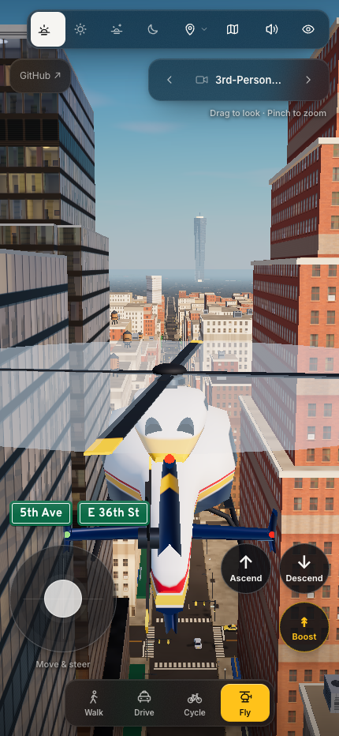
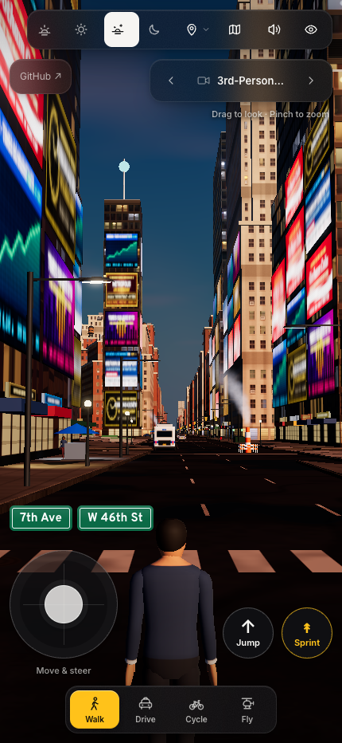
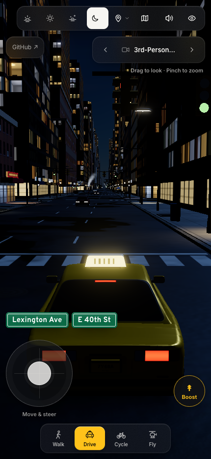
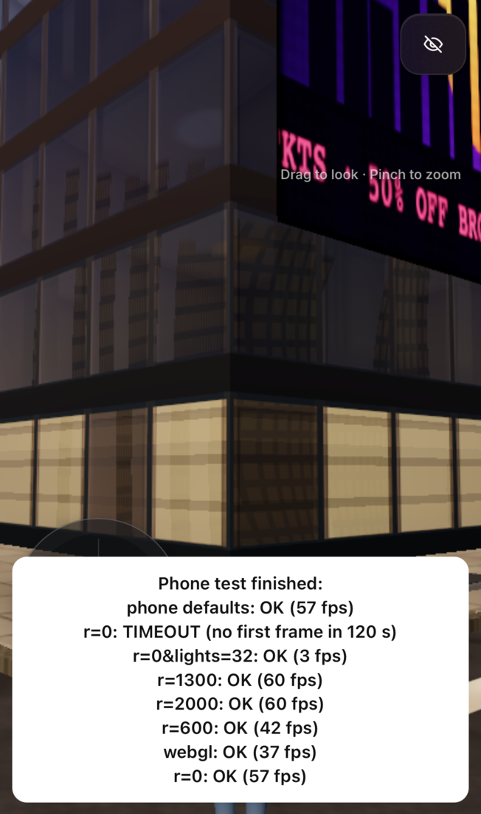

# Market Rush — Lagos prototype

A playable prototype: the Slop New York Mini city engine, re-graded for Lagos. Same Midtown street
geometry, warm dust-and-terracotta palette, danfo-yellow interface.

**This is an engine and look test, not a Lagos map.** The buildings and streets are still Manhattan.
Replacing them with Lagos Island or Abuja CBD geometry is the next step (see `tools/`).

## Game features

- **Seven ways to move.** Walk or sprint, drive a yellow cab, a Lagos danfo minibus, a police rapid-response
  car or a tricycle, pedal a bicycle, or fly a helicopter with climb/descent and boost.
- **A living street simulation.** AI traffic, buses and pedestrians follow a real 1:1-scale road network,
  obey signal cycles and use crosswalks. Vehicles react to each other, honk when blocked and the police run
  sirens. `B` sounds your horn.
- **Lagos re-skin.** Nigerian street and district names overlay the underlying grid, with landmarks such as
  Aso Rock Complex, Alausa Secretariat, Third Mainland Bridge and the Lekki-Ikoyi Link Bridge. Palettes are
  re-graded warm terracotta/ochre with danfo-yellow HUD accents. The geometry is still the original Manhattan.
- **Four atmospheres.** Switch between Golden Hour, Sunny Midday, Blue Hour twilight and Night 23:00. Each
  preset changes sun/sky/fog, exposure, bloom and colour balance; windows and street lights glow after dark.
- **Free exploration.** Open the full street map with `M`, search streets, pan/zoom and click to teleport.
  Eight landmark teleport shortcuts jump straight to the major viewpoints.
- **Many camera angles.** Cycle with `V`: third-person chase, low-angle action, first-person/cockpit,
  landmark scenic cameras (Balogun Market Crossroads, Marina, Aso Rock, waterfront, etc.) and an auto-director
  aerial. Keys `5`–`0` jump directly to specific presets.
- **Procedural audio.** Engine and rotor voices, tyres, horns, sirens, footsteps and wind are synthesised with
  Doppler, distance attenuation and building occlusion. `N` mutes/unmutes.
- **A place to come home to.** A "My Sanctuary" house on Lagos Island shows your current vehicle; drive or
  walk to the doorstep to step inside and back out again.
- **HUD and telemetry.** Speed, altitude, current street/location, active mode and camera, FPS counter and a
  per-mode control hint bar. `H` toggles a clean view.
- **Keyboard, gamepad and touch.** On phones, `?phone` trims trees and shadows and limits the build to the
  compact core area; `?full` forces the full city.

## What changed from the fork

| file | change |
|---|---|
| `js/boroughs.js` | `PALETTE`: 7 facade swatch families re-graded warm (terracotta, ochre, cream, weathered concrete) |
| `js/lighting.js` | all four time-of-day presets: sun, hemisphere, sky and fog re-graded, haze density raised |
| `js/controllers.js`, `js/actor-models.js` | two new playable road vehicles: Lagos danfo minibus and police rapid response |
| `index.html` | title, loader and HUD renamed; GitHub link points at the upstream mini |
| `css/style.css` | GPU-lost link accent matched to the brand yellow |
| `electron/`, `package.json` | desktop app wrapper (Windows/macOS/Linux) |
| `vendor/three/`, `tools/vendor-three.mjs` | three.js pinned build vendored locally so the game runs offline |

## Run it as a desktop app

Requires Node.js 20+.

```
npm install
npm start
```

`npm run dev` opens DevTools, and `npm run dist` builds a Windows installer into `dist/` with
electron-builder (`npm run dist:dir` produces an unpacked app instead).

The app serves the game from its own `app://` scheme instead of a localhost port, so there is no
server process to manage. three.js and all game assets are bundled; the Google Fonts stylesheet is
the only optional network request, and the UI falls back to system fonts offline.

## Run it in a browser

Serve the folder over http (not `file://`):

```
python -m http.server 8000
```

Open `http://localhost:8000`. Add `?phone` for the phone mode (no trees, no shadows, Midtown only).

## Controls

- `1` walk, `2` yellow cab, `Z` danfo minibus, `X` police cruiser, `3` bicycle, `4` helicopter
- WASD / arrows move or drive, `Shift` boost, `Space` jump / ascend, `B` horn, `V` cycle camera, `M` map, `N` sound, `H` hide HUD
- Mouse or touch to look around

## Screenshots

| Golden hour from the air | Balogun Market Crossroads at twilight |
|---|---|
|  |  |

| Danfo-style cab at night | Phone mode |
|---|---|
|  |  |

## Licence and data

Code: MIT. This repository is a fork of [mattiaongit/slop-newyork-mini](https://github.com/mattiaongit/slop-newyork-mini),
which is a fork of [mrdoob/slop-newyork](https://github.com/mrdoob/slop-newyork) by Ricardo Cabello. The original
copyright notice is retained in `LICENSE`.

Map data: New York City Open Data and © OpenStreetMap contributors (ODbL). Attribution must stay visible.

three.js is vendored from the build commit pinned in `index.html`; see `vendor/three/` and
`tools/vendor-three.mjs`. It remains MIT-licensed.
